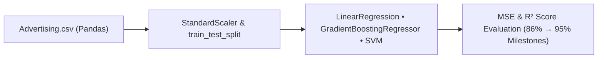

# Sales Prediction Using Python (`Sales-Prediction-using-Python`) — Ad-Spend Regression Modeling

A supervised machine learning regression project (`Sales Prediction using Python.ipynb`, 27 cells) forecasting product sales from multi-channel advertising spend (`Advertising.csv`), comparing **Linear Regression**, **Support Vector Machines**, and **Gradient Boosting** (reaching **86% -> 95%** accuracy milestones).

---

## 1. Executive Summary & Purpose
`Sales-Prediction-using-Python` quantifies the marginal return of advertising channels on product sales, enabling marketing teams to forecast revenue outcomes before committing ad budgets.

## 2. Pipeline Architecture & Layers


| Layer | Tools & Methods |
| :--- | :--- |
| **Data & Preprocessing** | `pandas`, `numpy`, `StandardScaler`, `train_test_split` |
| **Visualization** | `matplotlib.pyplot`, `seaborn` |
| **Regression Models** | `LinearRegression`, `GradientBoostingRegressor`, `sklearn.svm` |
| **Evaluation** | `mean_squared_error`, `r2_score`, `classification_report` |

## 3. Getting Started
```bash
git clone https://github.com/islamsamyy/Sales-Prediction-using-Python.git
cd Sales-Prediction-using-Python
jupyter notebook "Sales Prediction using Python.ipynb"
```

## 4. Business Value & Growth Opportunities
- **Marketing Mix Optimization (MMM)**: Helps agencies (like `spider-marketingagencyplateform`) reallocate client ad spend toward the highest-ROAS channels using data rather than intuition.
- **Budget Simulator API**: Deploy the trained `GradientBoostingRegressor` behind a REST endpoint so marketers can interactively simulate *"What happens to sales if we shift 20% of TV/print spend to digital?"*.
