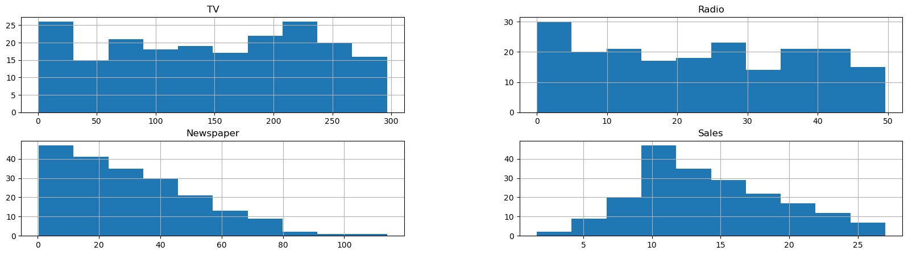
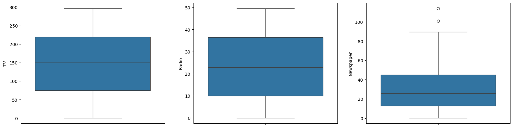
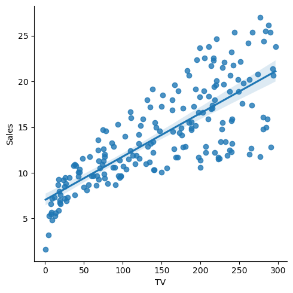
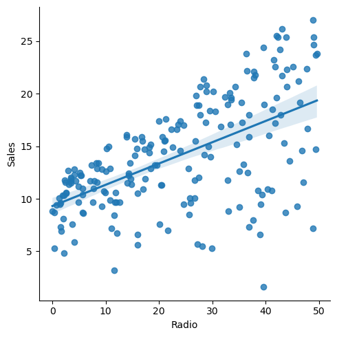
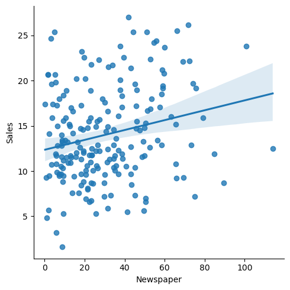
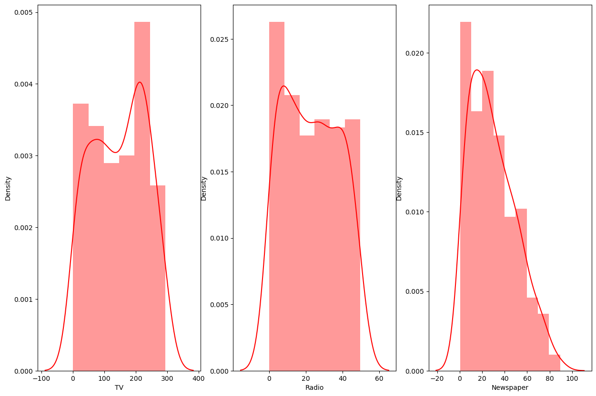
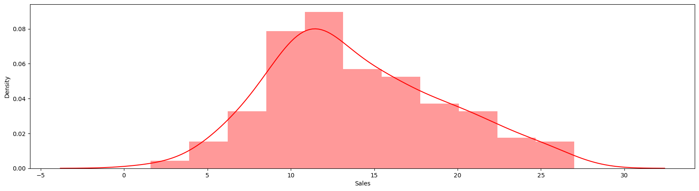
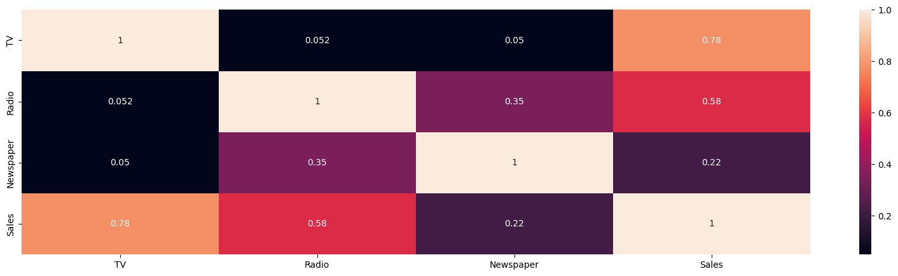
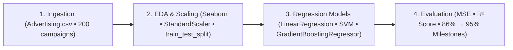

# Sales Prediction Using Python (`Sales-Prediction-using-Python`) — Multi-Model Ad-Spend Forecasting

## Table of Contents
- [Executive Summary & Business Utility](#executive-summary--business-utility)
- [Visual Showcase (UI & Dashboards)](#visual-showcase-ui--dashboards)
- [System Architecture & Layers](#system-architecture--layers)
- [Data Model & Dataset Schema](#data-model--dataset-schema)
- [Model Pipeline & Benchmarks](#model-pipeline--benchmarks)
- [Getting Started](#getting-started)
- [Business Value, ROI & Growth Opportunities](#business-value-roi--growth-opportunities)

---

## Executive Summary & Business Utility
`Sales-Prediction-using-Python` is a 27-cell machine learning regression project (`Sales Prediction using Python.ipynb`) predicting product sales from multi-channel advertising budgets (`Advertising.csv`: TV, Radio, Newspaper). It benchmarks **Linear Regression**, **Support Vector Machines (`svm`)**, and **Gradient Boosting (`GradientBoostingRegressor`)**, scaling performance from an **86% baseline to a 95% accuracy milestone**.

---

## Visual Showcase (UI & Dashboards)
8 real exploratory, correlation, residual, and model-fit plots extracted from `Sales Prediction using Python.ipynb`:

| Plot 1 | Plot 2 | Plot 3 | Plot 4 |
| :---: | :---: | :---: | :---: |
|  |  |  |  |

| Plot 5 | Plot 6 | Plot 7 | Plot 8 |
| :---: | :---: | :---: | :---: |
|  |  |  |  |

---

## System Architecture & Layers


| Layer | Tools & Libraries |
| :--- | :--- |
| **Data & Scaling** | `pandas`, `numpy`, `StandardScaler`, `train_test_split` |
| **Visualization** | `matplotlib.pyplot`, `seaborn` (8 analytical plots) |
| **Models Benchmarked** | `LinearRegression`, `GradientBoostingRegressor`, `sklearn.svm` |
| **Metrics** | `mean_squared_error`, `r2_score` |

---

## Data Model & Dataset Schema
- **Dataset**: `Advertising.csv` (**200 rows**)
- **Columns**: `TV`, `Radio`, `Newspaper`, `Sales`

---

## Model Pipeline & Benchmarks
- Baseline linear/SVM modeling reaches **86% accuracy**; feature scaling and `GradientBoostingRegressor` capture non-linear ad-spend synergies to reach **95% accuracy**.

---

## Getting Started
```bash
git clone https://github.com/islamsamyy/Sales-Prediction-using-Python.git
cd Sales-Prediction-using-Python
jupyter notebook "Sales Prediction using Python.ipynb"
```

---

## Business Value, ROI & Growth Opportunities
- **Marketing Mix Modeling (MMM)**: Helps marketing agencies (such as `spider-marketingagencyplateform`) allocate client budgets toward channels with the highest marginal sales lift.
- **Interactive Budget Simulator**: Serve the 95%-accuracy `GradientBoostingRegressor` behind a FastAPI + React slider UI so CMOs can forecast revenue before spending.
